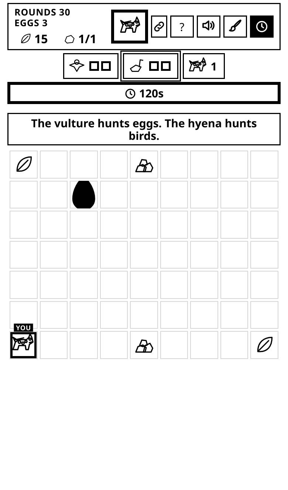

# Who can see what, 2026-11-08

The rules in `docs/reviews/RULEBOOK-v2-2026-11-07.md` are the source of truth, including the sight table in section 10 and the announcements in section 11.

Checked by playing each mode on this computer and reading the message the server sends to each seat. That message is what the phone receives. The pictures are the same iPhone size as real play (390 by 664). No game code was changed. A fix for the hunter egg leak is already in another pull request.

The animal is called the badger. A few of the pictures still show the old two-word name, because that rename is a separate change.

## Decision updates — Brian, 2026-11-08

The original audit below predates Brian's decisions. Full read-only god view for knocked-out birds, team egg/found-egg sharing and finished-game full reveal are intentional, not current leaks. Found-egg hunter packets and revealing wreckage taps are fixed in PR #23.

**Kick correction:** the kicker must see the full slide and actual landing, even beyond normal sight or when an obstruction stops it early. Only that kicker gets this exception. The kicked hunter sees its own slide; other watchers retain their ordinary sight filtering. An early stop can let the kicker infer a blockage; Brian accepts that trade-off. No extra obstruction coordinate or identity is added. The earlier kick-landing privacy fix is reversed for the kicker only; tests cover normal travel, wrecked-square stops and animal stops in 3p, Hunters and 5p. RULEBOOK 5.2, 7.1 and the sight table now match.

## Original audit observations (superseded where noted)

1. A hunter can see a found egg. In 3 players, Hunters, and 5 players, the phone is sent the square and draws a filled egg. Tapping it says "Found egg". The hunter still cannot see the birds. This matches what Brian reported. Picture: `busy-2026-11-08/3p-hunter-sees-found-egg.jpg`.
2. A knocked-out bird, while everyone else is still playing, is sent the whole board: every egg, and the hunter's square even if that hunter is buried or far away. The code does this on purpose for a player who is out. The rulebook does not allow it.
3. **Accepted kicker-only exception:** after a kick, the ostrich is explicitly allowed the actual landing and full slide, even outside its ordinary sight. Other watchers do not gain it.
4. In 2 vs 2 and in 5 players, each ostrich is shown the other ostrich's eggs, warmth number and all. The rulebook says an ostrich sees its own eggs. The How to play page says either ostrich can warm any egg, so Brian may want the rulebook changed instead of the code.
5. In those same modes, the vulture who did not find an egg is still sent the exact square the other vulture found. The How to play page says they share a sniff (yes or no), not the exact egg.
6. A wrecked square looks the same to everyone, which is right, because nobody can land there. If the wreck used to be an egg, a tap says "Smashed" rather than "Wrecked", so a hunter can learn an egg was there.
7. When the game is over, a hunter's message includes every egg square and where a caught bird landed. During the game that landing is hidden. The end screen is mostly words. This matters less because the game is finished.

The scramble landing itself is hidden from hunters during play. That part is working.

## How a phone is filtered

Each seat gets its own view (`server.js` `view`, `view3`, `viewH`, `viewT`). The websocket sends that view and nothing else. There is no extra debug copy of the whole game.

Hunters are not sent bird coordinates during play (those come through as off the board). They are not sent the scramble square (`lastCatch.to` is empty). They are not sent the vulture's sniff. A buried badger's mound goes only to a bird who saw the dig. The exact square of a bird next to a buried badger goes only to the badger.

The found-egg mark is the hole. `game.js` line 270 treats a found egg as one of the marks everyone may see. The hunter views copy those marks (`server.js` lines 120, 230 and 322). The phone then draws a filled egg for anyone who is not the ostrich (`public/ui.js` line 379). The Hunters-mode computer is already denied that mark (`huntai.js` line 5). The human phone is not.

## Table

"Should see" is the rulebook. "Actually" is what the message contained, and what the phone drew when we looked.

| Mode | Role | Event | Should see | Actually sent or shown | Result | Where |
|---|---|---|---|---|---|---|
| Classic | Vulture | Eggs it has not found | No squares | No egg list. Only a yes/no sniff around its own landing. | Pass | `server.js:51`, `game.js:270` |
| Classic | Vulture | An egg it found by landing on it | That square | Found-egg mark, and the phone draws it. | Pass | `game.js:270`, `public/ui.js:379` |
| Classic | Ostrich | Its own eggs | All of them | Full egg list, with warmth numbers, drawn on the board. | Pass | `server.js:51` |
| Classic | Both | A stone smashes a hidden egg | The vulture learns because it threw. The ostrich already knew the egg. | Both get the square as a wreck. No leftover egg icon. | Pass | `server.js:45` |
| 3 players | Hyena | A found egg, game still going | Never | The square is in the message. The phone draws a filled egg. Tip says "Found egg". Birds stay hidden. | LEAK | `server.js:120`, `public/ui.js:379` |
| Hunters | Hyena and badger | A found egg, game still going | Never | Same found-egg mark on both hunter phones. | LEAK | `server.js:322`, `public/ui.js:379` |
| 5 players | Hyena | A found egg, game still going | Never | Same found-egg mark. The bird list is empty. | LEAK | `server.js:230`, `public/ui.js:379` |
| 3 players | Hyena | Where a caught bird fled | Never, during play | Landing is empty. Bird positions are off the board. Claws stay on the hyena. | Pass | `server.js:112` |
| Hunters | Hyena, the one who caught | Where the bird fled | Never, during play | Landing is empty. | Pass | `server.js:313` |
| Hunters | Badger, the other hunter | Where the catch happened, and where the bird fled | Neither square | Both empty. No claws on the badger's board. The words still say who caught whom. | Pass | `server.js:313` |
| 5 players | Hyena | Where the caught ostrich fled | Never, during play | Landing is empty. | Pass | `server.js:214` |
| 3 players, Hunters, 5 players | Birds | Where the caught bird fled | Yes, birds see birds | Landing is sent, and the bird is drawn on its new square. | Pass | `server.js:112` |
| 5 players | Vulture far from the hunter | The square the catch happened on | Only if that vulture can see the hunter | The catch square is left out of the message. | Pass | `server.js:214` |
| Any mode with hunters | A bird who was watching | The square a caught bird just left | Hunters only within 2 squares | The message hides the pin. The bird picture still jumps, so a player who was watching can work out the hunter's square. | Pass for the message | Birds always see birds (`server.js` bird coordinates) |
| 3 players | Ostrich, knocked out, game still going | Hunter's square and every egg | No new sight | The message is a full board: hunter square included. | LEAK | `server.js:131` |
| 3 players | Vulture, knocked out, game still going | Eggs it never found | No | The same knocked-out view adds every egg. | LEAK | `server.js:133` |
| Hunters | A knocked-out bird | Same, game still going | No | Same full board, both hunters included. | LEAK | `server.js:332` |
| 5 players | A knocked-out bird | Same, game still going | No | Same full board. | LEAK | `server.js:245` |
| 2 vs 2 and 5 players | Each ostrich | The other ostrich's eggs | Own eggs only | All four eggs, with nest and warmth. The other nest is drawn (blue dashed eggs on Ostrich 1's phone). | LEAK vs the rulebook | `server.js:225`, `server.js:241` |
| 2 vs 2 and 5 players | The other vulture | An egg its partner found | Only eggs it found itself | Exact square in the found-egg marks, in the move note, and as the partner's sniff. | LEAK | `server.js:224`, `server.js:230` |
| 3 players | Ostrich or vulture | Badger burrows where they did not see it | No square | No mound and no hunter. | Pass | `server.js:385` |
| 3 players | Vulture who saw the dig | The mound | That square, while the badger stays buried | Mound square sent. The badger's body is not drawn on top. | Pass | `server.js:385` |
| 3 players | Badger, buried, bird next to it | That bird's exact square | Yes, ambush sight | Exact square, only on the badger's phone. | Pass | `three.js` ambush sight, `server.js` hunter view |
| 3 players | Hyena | Ambush sight | No | Empty. | Pass | `server.js` hunter view |
| Hunters | Birds far away | Hunters meet | The words, not the square | "Hyena shoved the badger." No square. Neither hunter drawn. | Pass | `server.js:315` |
| Hunters | Hyena and badger | Hunters meet | They can see each other | The landing square is sent, and both are drawn. | Pass | `server.js:315` |
| Hunters | Vulture who cannot see the hyena | Badger bursts and shoves the hyena | Words, not the landing | Landing left out. | Pass | `server.js` burst filter in `stamp` |
| 3 players, Hunters, 5 players | Kicking ostrich only | Kick travels beyond ordinary sight or stops early | Full actual slide and landing, by Brian’s decision | Explicit kick trail, kick landing and move-note landing sent to the kicker; animation follows every step. Other watchers stay filtered. | Intentional exception; tested | `server.js` kicker override in `stamp`; `testviewprivacy.js`; `e2e-motion-views.js` |
| 3 players | Hyena | Same kick | Its own new square | It has its own square. It does not gain a hidden egg. | Pass | `server.js:120` |
| All hunter modes | Hunter | Game over | Rules never give eggs | Every egg square, both birds, and the scramble landing are in the message. | LEAK, low, game is over | `server.js:124`, `server.js:112` |
| All | Everyone | How many eggs are left | A count is not a square | The header shows the count on every phone. | Pass | `public/ui.js` header |
| All | Everyone | Ostrich hunger and vulture stones | The phone treats these as public | Shown in the header. | Pass | `public/ui.js:326` |
| All hunter modes | Hunter | A smashed egg versus a plain wreck | A wreck is public. An egg is not. | Same X on the board. A tap says "Smashed" only if an egg was there. | LEAK, small | `public/ui.js:377` |
| Classic, pass and play | One phone | Both seats | One device hands the phone over | Both views are sent to that one phone. | Not a leak between players | `server.js` pass broadcast |

## What is already right

Hunters do not learn where a caught bird scrambled, while the game is going. The other hunter does not even learn the catch square. A buried badger stays hidden from a bird who did not see it dig. Ambush sight stays on the badger's phone. The classic vulture does not receive eggs it has not found.

The found-egg leak is the one Brian already saw. Leave the fix to the other pull request.

## Update 2026-11-08
Brian decided catches show only in the animal chip row above the board. No claw or heart mark is drawn on a caught bird's square for any viewer.
